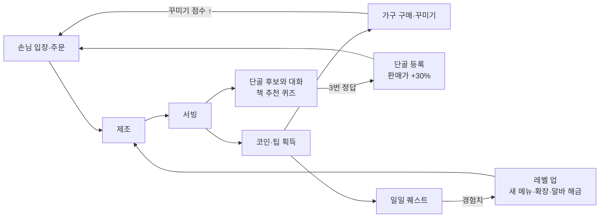

# 📚☕ 북카페 타이쿤 (BookStair)

> **책을 읽고 싶지만 실천이 어려운 사람**이 게임을 하면서 자연스럽게 책과 가까워지도록 만든
> **북카페 경영 시뮬레이션 웹 게임**
>
> 커피를 만들어 팔고, 손님이 들려주는 줄거리와 감상만 듣고 딱 맞는 책을 추천해 단골로 만듭니다.

| 항목 | 내용 |
|---|---|
| 과제 | Project 1 (개인 프로젝트) |
| 제작 | 유채원 (디지털경영전공) |
| 장르 | 경영 시뮬레이션 · 타이쿤 · 캐주얼 |
| 타깃 | 책을 읽고 싶지만 실천이 어려운 사람 |
| 플랫폼 | 웹 브라우저 (PC 권장, 작은 화면 대응) |
| 실행 | 설치 없이 [`index.html`](index.html) 한 파일을 브라우저로 열면 바로 실행 |
| 기술 | HTML · CSS · JavaScript (외부 라이브러리 없음), Canvas 2D, localStorage |
| 규모 | 약 8,000줄 · 메뉴 58종 · 책 49권 · 단골손님 50명 · 인테리어 테마 6종 · 가구 약 180종 · 뱃지 56개 |

---

## 목차

1. [기획 배경과 목표](#1-기획-배경과-목표)
2. [실행 방법](#2-실행-방법)
3. [게임 흐름](#3-게임-흐름)
4. [화면 구성과 조작법](#4-화면-구성과-조작법)
5. [게임 시스템 상세](#5-게임-시스템-상세)
6. [기술 구현](#6-기술-구현)
7. [UI/UX 설계](#7-uiux-설계)
8. [개발 과정](#8-개발-과정)
9. [한계와 앞으로 할 일](#9-한계와-앞으로-할-일)
10. [부록: 상세 자료](#10-부록-상세-자료) — 단골 50명, 책 49권, 뱃지 56개, 가구, 판정 기준, 공식, 저장 구조, 함수 목록

---

## 1. 기획 배경과 목표

### 1-1. 문제의식

"올해는 책 좀 읽어야지" 하고 마음먹지만 실제로 끝까지 읽는 사람은 많지 않습니다.
책을 읽고 싶은 마음이 없어서가 아니라, 시작하기까지 걸림돌이 많기 때문입니다.

| 걸림돌 | 실제 모습 |
|---|---|
| **무엇을 읽을지 모름** | 서점이나 도서관에 가도 책이 너무 많아서 고르다가 지침 |
| **시작이 부담스러움** | 두꺼운 책을 펼치는 것 자체가 큰 결심이 필요함 |
| **꾸준히 이어지지 않음** | 몇 쪽 읽다가 바빠지면 그대로 멈춤 |
| **재미를 붙일 계기가 없음** | 책 이야기를 나눌 사람이 없어서 혼자서는 흥미가 금방 식음 |

반면 짧은 시간에 가볍게 즐기는 게임은 매일 손이 갑니다.
그래서 **이미 습관이 된 게임 시간 안에 책을 넣으면, 책을 시작하는 문턱을 낮출 수 있지 않을까**라는 질문에서 출발했습니다.

### 1-2. 해결 방향

책을 "읽어야 하는 것"이 아니라 **게임 속에서 자연스럽게 만나는 것**으로 바꾸는 것을 목표로 했습니다.

| 걸림돌 | 북카페 타이쿤의 해결 방법 |
|---|---|
| 무엇을 읽을지 모름 | 6개 장르, 고전·스테디셀러 49권을 손님의 **줄거리 한 줄, 감상 한 줄**로 맛보게 함. 여러 손님을 만나다 보면 내가 끌리는 장르와 책을 발견하게 됨 |
| 시작이 부담스러움 | 책 한 권을 읽는 대신 **대화 한 번(몇 초)**으로 책을 접함. 정답을 고르는 퀴즈라서 공부가 아니라 놀이로 느껴짐 |
| 꾸준히 이어지지 않음 | 일일 퀘스트(책 추천 맞히기 포함), 레벨 성장, 계절 한정 메뉴로 **매일 조금씩 들어오는 습관 구조**를 만듦 |
| 재미를 붙일 계기가 없음 | 직업과 취향이 있는 **단골손님 50명**이 "이 책 정말 좋았어요"라고 이야기해 주고, 독서 클럽 기능으로 함께 읽는 분위기를 보여 줌 |
| 내가 뭘 알게 됐는지 안 보임 | 맞힌 책이 **단골 도감**에 손님별로 쌓여서, 게임을 할수록 "알게 된 책 목록"이 늘어남 |

여기에 게임 자체의 재미도 놓치지 않으려고 했습니다. 카페 운영, 제조 미니게임, 인테리어 꾸미기가 계속 들어오게 하는 재미를 맡고, 책 추천은 그 사이사이에 자연스럽게 끼어듭니다.
꾸미기 점수가 오르면 단골 후보가 더 자주 오고, 단골이 되면 판매가가 30% 오르는 식으로 **책 추천을 잘할수록 카페도 잘되게** 연결했습니다.

### 1-3. 타깃 사용자

**주 타깃: 책을 읽고 싶지만 실천이 어려운 사람**

| 항목 | 내용 |
|---|---|
| 상황 | 독서를 해야겠다는 마음은 있지만 바쁘거나 부담스러워서 시작하지 못하는 대학생·직장인 |
| 평소 습관 | 쉬는 시간에 짧게 모바일·웹 게임을 즐김 |
| 필요한 것 | 무엇을 읽을지 골라 주는 안내, 부담 없는 시작, 꾸준히 이어 갈 계기 |
| 이 게임에서 얻는 것 | 책 49권의 줄거리와 감상을 놀이처럼 접하고, 내 취향의 장르를 발견하고, 읽어 보고 싶은 책 목록을 갖게 됨 |

**함께 고려한 사용자**

- 카페·인테리어 꾸미기를 좋아하는 캐주얼 게임 이용자
- 이미 책을 좋아해서 아는 책이 나오면 반가운 이용자

책은 처음 보는 사람도 알아들을 수 있도록 **누구나 한 번쯤 제목을 들어 본 고전과 스테디셀러**로 골랐습니다. 처음 보는 책이라도 줄거리 힌트만으로 맞힐 수 있습니다.

### 1-4. 핵심 재미 구조 (Core Loop)



- **짧은 루프 (몇 초):** 주문 → 제조 → 서빙 → 코인
- **중간 루프 (몇 분):** 가구 구매 → 꾸미기 점수 상승 → 손님 증가, 단골 후보에게 책 추천
- **긴 루프 (며칠):** 일일 퀘스트로 레벨 업 → 새 메뉴·카페 확장·알바 고용·2층 라운지 해금

---

## 2. 실행 방법

### 방법 1. 파일로 바로 열기 (권장)

1. 이 저장소에서 [`bookcafe-tycoon/index.html`](index.html)을 내려받습니다.
   (저장소 전체를 받으려면 GitHub 화면의 `Code → Download ZIP`)
2. `index.html`을 더블클릭해 크롬이나 엣지로 엽니다.

### 방법 2. 로컬 서버로 열기

```bash
cd bookcafe-tycoon
python -m http.server 8000
# 브라우저에서 http://localhost:8000 접속
```

### 참고

- **저장:** 진행 상황은 브라우저 `localStorage`에 자동 저장됩니다. 창을 닫았다 다시 열어도 이어서 할 수 있습니다.
- **초기화:** 오른쪽 위 **⚙️ 설정 → 처음부터 다시 → 초기화**를 누르면 모든 진행 상황이 지워집니다.
- **글꼴:** Google Fonts의 Jua 글꼴을 불러옵니다. 인터넷이 없으면 기본 글꼴로 보이지만 게임은 그대로 동작합니다.

---

## 3. 게임 흐름

### 3-1. 처음 시작할 때 (온보딩)

```
① 닉네임 입력 (최대 10자)
② 아바타 만들기 (성별·피부·눈·입·머리 모양·머리색·옷·모자)
③ 신규 점장 오픈 축하 선물
④ 숙련 튜토리얼: Lv.1 메뉴(아메리카노, 복숭아 아이스티) 레시피 배우기
⑤ 영업 시작
```

처음 하는 사람이 막히지 않도록 한 번에 하나씩만 보여 주고, 튜토리얼은 판정 구간을 평소보다 **1.6배 넓게** 잡아 쉽게 성공하도록 했습니다.

### 3-2. 기본 영업 흐름

```
손님 입장 → 빈 자리에 앉아 주문 말풍선
→ 제조 기구(커피머신 / 음료 바 / 케이크 진열대) 클릭해서 제조
→ 완성품 클릭해서 손에 들기 (최대 2개)
→ 주문한 손님 클릭해서 내기 → 코인 + 팁
→ 손님이 떠난 뒤 빈 접시 치우기
```

손님마다 **인내심 게이지**가 있어서 너무 오래 기다리게 하면 화를 내며 돌아갑니다.

---

## 4. 화면 구성과 조작법

### 4-1. 화면 구성

```
┌──────────────────────────────────────────────────────────────┐
│ [🔔 BOOK PARTY] [아바타 Lv.점장 ▬▬경험치]   🎨꾸미기 🎀우정 🪙코인 🥇금 ⚙️ │ ← 상단 HUD
│                                                       ┌──┐   │
│ ┌────┐                                                │🎁│ 일일 퀘스트
│ │주문│                                                │🗳️│ 인기투표
│ │알림│          카페 화면 (Canvas)                     │🏰│ 독서 클럽
│ └────┘                                                │📐│ 카페 확장
│ [👫친구들]                                            └──┘   │
│                                                              │
│ [손 ▢ ▢]                          [🔨꾸미기][🏰클럽][2F/1F][📖MENU] │ ← Dock
└──────────────────────────────────────────────────────────────┘
```

| 영역 | 들어 있는 것 | 배치 이유 |
|---|---|---|
| 상단 HUD | 이벤트 배지, 레벨·경험치, 재화 4종, 설정 | 계속 확인해야 하는 정보는 시선이 먼저 가는 위쪽에 |
| 오른쪽 이벤트 열 | 일일 퀘스트, 인기투표, 독서 클럽, 확장 | 남은 시간·진행도를 아이콘 아래 숫자로 바로 보여 줌 |
| 왼쪽 열 | 손님 주문 알림, 친구들 | 지금 처리해야 할 일을 한쪽에 모음 |
| 왼쪽 아래 | 손에 든 물건 2칸 | 무엇을 들고 있는지 헷갈리지 않게 |
| 오른쪽 아래 Dock | 꾸미기, 독서 클럽, 층 이동, 전체 메뉴 | 자주 누르는 버튼은 손이 가기 쉬운 오른쪽 아래에 |

### 4-2. 조작법

| 조작 | 동작 |
|---|---|
| 마우스 클릭 | 이동, 제조, 완성품 들기, 서빙, 접시 치우기, 단골 후보와 대화 |
| 🔨 꾸미기 → 드래그 | 가구 옮기기 |
| `R` | (꾸미기 중) 선택한 가구 회전 |
| `Delete` / `Backspace` | (꾸미기 중) 선택한 가구를 창고에 넣기 |
| `Esc` | 열린 창 닫기, 꾸미기 중이면 선택 해제 |
| `2F / 1F` 버튼 | 층 이동 (Lv.50부터) |
| `📖 MENU` | 상점, 아바타·알바, 도감·메뉴·뱃지, 인기투표, 친구/방명록 |

---

## 5. 게임 시스템 상세

### 5-1. 손님

| 항목 | 규칙 |
|---|---|
| 입장 간격 | `clamp(9 − 레벨 × 0.03, 3, 9)초 ÷ (1 + 꾸미기 방문 보너스)`에 ±30% 무작위. 레벨이 오르고 카페가 예쁠수록 손님이 자주 옴 |
| 인내심 | `(38 + 의자 편안함) × (1 + 꾸미기 인내심 보너스)`, 38~100 사이. 좋은 의자에 앉히면 더 오래 기다려 줌 |
| 책 구경 손님 | 책장·북스탠드가 있으면 책만 구경하러 오는 손님이 생기고, 책을 팔 수 있음 |
| 외모 | 피부 5종 × 머리색 8종 × 옷 색 8종을 시드값으로 조합해 손님마다 다르게 생성 |

### 5-2. 판매 가격과 팁

```
판매가 = 메뉴 기본가
       × 1.5  (계절 한정 메뉴일 때)
       × 1.1  (독서 클럽 대표가 방문 중일 때, 음료만)
       × 1.3  (단골손님일 때)
       × 1.2  (그 메뉴를 숙련도 PERFECT로 배웠을 때)

팁 = 판매가 × 0.3 × (남은 인내심 비율)  +  (PERFECT면 판매가 × 0.15)
```

빨리 내줄수록 팁이 커지므로, 손님이 몰릴 때 **무엇부터 처리할지** 판단하는 재미가 생깁니다.

### 5-3. 메뉴 58종

| 구분 | 수 | 제조 기구 | 해금 |
|---|---|---|---|
| 음료 | 30종 | 커피머신 / 음료 바 | Lv.1 아메리카노 ~ Lv.100 시공간 시그니처 블렌드 |
| 디저트 | 20종 | 케이크 진열대 (Lv.2부터 구매 가능) | Lv.2 플레인 스콘 ~ Lv.99 3단 애프터눈 티 세트 |
| 계절 한정 | 8종 (계절마다 2종) | 커피머신 / 음료 바 / 케이크 진열대 | Lv.3부터, 실제 날짜의 계절에만 주문이 들어옴 |

- **가격·경험치·제조 시간 공식:** 음료 가격 = `35 + 해금 레벨 × 2.4`, 제조 시간 = `2.6초 + 레시피 단계 수 × 0.4초`. 높은 레벨 메뉴일수록 비싸고 만드는 데 오래 걸립니다.
- **레시피 배우기:** 새 메뉴가 열려도 바로 팔 수 없습니다. 선배에게 레시피(머그잔 → 그라인더 → 탬핑 → 샷 → 스팀 …)를 순서대로 배워야 손님이 주문합니다.
- **미리 만들기:** 기구 하나에서 한 번에 5잔씩 만들어 둘 수 있습니다.

<details>
<summary><b>전체 메뉴 목록 펼치기</b></summary>

**음료 30종** (괄호 안은 해금 레벨)

복숭아 아이스티(1) · 아메리카노(1) · 아이스 아메리카노(2) · 카페라떼(3) · 바닐라라떼(4) · 녹차(5) · 카푸치노(7) · 헤이즐넛 아메리카노(9) · 카라멜 마키아토(12) · 녹차라떼(15) · 초코라떼(18) · 토피넛 라떼(22) · 연유 라떼(26) · 아인슈페너(30) · 자몽 에이드(34) · 청포도 에이드(38) · 얼그레이 밀크티(42) · 고구마 라떼(46) · 민트초코 라떼(50) · 콜드브루(55) · 콜드브루 라떼(60) · 말차 에스프레소(65) · 자몽 허니 블랙티(70) · 아포가토(75) · 핸드드립(80) · 플랫 화이트(85) · 체리 에이드(90) · 샤인머스캣 스무디(93) · 로얄 밀크티(97) · 시공간 시그니처 블렌드(100)

**디저트 20종**

플레인 스콘(2) · 초코칩 쿠키(4) · 슈크림빵(6) · 버터 크로와상(10) · 휘낭시에(14) · 치즈케이크(19) · 티라미수(24) · 가나슈 롤케이크(29) · 마카롱 3종(35) · 에그 타르트(40) · 베이글&크림치즈(48) · 아이스크림 브라우니(54) · 브라운 슈가 와플(60) · 딸기 생크림 케이크(68) · 생체리 타르트(74) · 당근 크림치즈 케이크(80) · 크로플(86) · 앙버터 다쿠아즈(90) · 파블로바(95) · 3단 애프터눈 티 세트(99)

**계절 한정 8종**

| 계절 | 음료 | 디저트 |
|---|---|---|
| 🌸 봄 (3~5월) | 벚꽃 딸기 라떼 | 쑥 인절미 찰떡 |
| 🌊 여름 (6~8월) | 청귤 스파클링 에이드 | 눈꽃 팥빙수 |
| 🍂 가을 (9~11월) | 밤 아인슈페너 | 단호박 타르트 |
| ❄️ 겨울 (12~2월) | 시나몬 뱅쇼 | 갓 구운 붕어빵 세트 |

</details>

### 5-4. 제조 미니게임 (숙련도)

음료 레시피를 배울 때 단계별 타이밍 미니게임을 합니다.

```
원두 갈기 → 탬핑 → 샷 추출 → 스팀 우유 또는 붓기
```

- 단계마다 **PERFECT / GREAT / GOOD / FAIL**로 판정합니다.
- 최종 등급은 단계 평균으로 정하고, FAIL이 2번 이상이면 전체 FAIL입니다.
- 가장 좋은 등급이 저장되고, **PERFECT를 받은 메뉴는 판매가 +20%에 팁 보너스**가 붙습니다. 그래서 이미 배운 메뉴도 다시 연습할 이유가 생깁니다.

### 5-5. 책 추천과 단골 시스템 (이 게임만의 핵심 기능)

**Lv.5**부터 단골 후보 손님이 찾아옵니다.

```
단골 후보 입장 → 클릭해서 대화
→ 손님이 책 제목 없이 "줄거리" 또는 "읽고 느낀 점"을 이야기함
→ 보기 4권 중에서 고르기 (정답 1 + 같은 장르 1 + 다른 장르 2)
→ 정답이면 하트 +1, 3개를 모으면 단골 등록
```

| 항목 | 내용 |
|---|---|
| 장르 6개 | 추리 · SF · 로맨스 · 인문학 · 자기계발 · 판타지 |
| 책 49권 | 『셜록 홈즈의 모험』, 『코스모스』, 『오만과 편견』, 『사피엔스』, 『미움받을 용기』, 『어린 왕자』 등 고전·스테디셀러 |
| 책마다 대사 2개 | 줄거리 1줄 + 읽고 느낀 점 1줄. 맞힌 횟수에 따라 번갈아 나오고, 대표 책을 맞히면 같은 장르의 다른 책을 찾아서 같은 손님이라도 문제가 달라짐 |
| 단골손님 50명 | 이름·직업·좋아하는 장르·대표 책이 정해져 있음. 예: 개발자 김민재(SF, 『코스모스』), 기관사 오건우(추리, 『오리엔트 특급 살인』) |
| 난이도 설계 | 같은 장르 오답을 1권 섞어서 장르만 보고 찍기 어렵게 함 |
| 보상 | 단골 등록 순간 코인(200 + 레벨×10)과 금 3개. 이후 단골이 사는 메뉴는 판매가 +30%. 꾸미기 점수가 높으면 단골 등장 확률이 최대 +15%p |

손님 직업과 좋아하는 책이 이어지도록 설정했습니다. 예를 들어 해양생물학자는 『해저 2만 리』, 수학 강사는 『용의자 X의 헌신』을 찾습니다.

### 5-6. 인테리어와 꾸미기 점수

**테마 6종** — 테마마다 카운터·테이블·의자·책장·조명·벽지·바닥 세트가 있습니다.

| 테마 | 콘셉트 | 가격 배율 | 제조 속도 | 의자 편안함 |
|---|---|---|---|---|
| 🪵 클래식 원목 | 포근한 전통 북카페 | ×1.0 | ×1.0 | 2 |
| 🌼 프로방스 내추럴 | 플라워 패턴·화이트 우드·식물 | ×1.4 | ×1.15 | 6 |
| 📻 레트로 빈티지 | 8090 다방 & LP판 | ×1.5 | ×1.2 | 5 |
| 🖤 모던 블랙&화이트 | 심플한 도시 감성 | ×1.6 | ×1.3 | 4 |
| 🏮 오리엔탈 한옥 | 전통 문살·좌식 평상·놋그릇 | ×1.8 | ×1.25 | 8 |
| 💎 럭셔리 골드/파스텔 | 마블 & 핑크 골드 (금으로만 구매) | 금 전용 | ×1.8 | 14 |

비싼 테마일수록 제조가 빠르고 손님이 오래 기다려 줍니다. 무엇을 먼저 살지 **투자 판단**을 하게 만들려는 설계입니다.

**꾸미기 점수**

```
꾸미기 점수 = 가구 점수 합 + 벽지·바닥 점수 + 테마 세트 보너스
테마 세트 보너스 = 같은 테마 5개 이상이면 +15, 10개 이상이면 +40 (테마별로 따로 계산)
```

점수가 600점에 가까워질수록 효과가 커지고, 600점에서 최대가 됩니다.

| 효과 | 최대치 |
|---|---|
| 손님 방문 빈도 | +50% |
| 손님 인내심 | +30% |
| 단골 후보 등장 확률 | +15%p |

벽과 바닥은 색을 직접 바꿀 수 있고, 카페 밖 풍경은 실제 계절(벚꽃·초록·단풍·눈)을 따라갑니다.

### 5-7. 카페 확장 · 알바 · 2층 라운지

**카페 확장 (8×8 → 13×13)**

| 단계 | 필요 레벨 | 크기 | 비용 |
|---|---|---|---|
| 1 | Lv.4 | 9×9 | 2,000 코인 |
| 2 | Lv.16 | 10×10 | 8,000 코인 + 금 10 |
| 3 | Lv.25 | 11×11 | 20,000 코인 + 금 30 |
| 4 | Lv.75 | 12×12 | 60,000 코인 + 금 100 |
| 5 | Lv.100 | 13×13 | 150,000 코인 + 금 250 |

**알바 고용 (최대 4명)** — 자리는 Lv.5 / 10 / 50 / 100에 하나씩 열립니다.

| 알바생 | 동물 | 이동 속도 | 한마디 |
|---|---|---|---|
| 민지 | 토끼 | ×1.0 | 책 정리는 맡겨 주세요! |
| 준호 | 강아지 | ×1.2 | 배달 알바 3년 차, 발이 빨라요. |
| 예린 | 고양이 | ×0.95 | 라떼아트 예선 통과했어요 ☕ |
| 태양 | 곰 | ×1.1 | 박자 맞춰 일하면 하나도 안 힘들어요! |
| 소라 | 양 | ×0.9 | 손님 얼굴은 한 번 보면 안 잊어요. |
| 하늘 | 여우 | ×1.3 | 카페 경력 5년! 뭐든 빨라요. |

**2층 독서 라운지 (Lv.50)** — 6×6으로 열리고 10레벨마다 한 칸씩 넓어집니다. 손님이 빈 의자에 앉아 책을 읽다가 일어날 때 이용료를 냅니다. 1층을 보고 있는 동안에도 2층 영업은 계속 돌아갑니다.

### 5-8. 성장: 레벨 · 퀘스트 · 뱃지 · 재화

**레벨 (1 → 100)**

- 다음 레벨까지 필요한 경험치 = `15 + 10 × 현재 레벨`
- 경험치는 **일일 퀘스트로만** 쌓입니다. 무작정 오래 플레이하기보다 매일 조금씩 들어오도록 유도하려는 설계입니다.
- 레벨 업마다 금 2개를 받고, 새로 열린 메뉴·확장·알바 자리를 팝업으로 알려 줍니다.

| 레벨 | 열리는 것 (주요 항목) |
|---|---|
| Lv.2 | 케이크 진열대·디저트 |
| Lv.3 | 계절 한정 메뉴 |
| Lv.4 | 첫 카페 확장 |
| Lv.5 | 단골손님 & 책 추천 대화, 알바 1번째 자리 |
| Lv.10 | 알바 2번째 자리 |
| Lv.50 | 2층 독서 라운지, 알바 3번째 자리 |
| Lv.100 | 마지막 확장(13×13), 알바 4번째 자리, 시그니처 블렌드 |

**일일 퀘스트** — 하루 6개가 3칸에 나눠 나오고, 레벨에 따라 목표치가 커집니다.

| 종류 | 예시 |
|---|---|
| ☕ 서빙 | 손님 N명에게 내기 |
| 🪙 매출 | 코인 N 벌기 |
| 🍰 특정 메뉴 | ○○ 2번 팔기 |
| 🧽 청소 | 빈 테이블 N번 치우기 |
| ⚡ 빠른 서빙 | 인내심이 절반 남았을 때 내기 N번 |
| 🫘 로스팅 | 원두 로스팅 2번 거두기 |
| 📚 책 판매 | 책 구경 손님에게 책 2권 팔기 |
| 💬 책 추천 | 단골 후보에게 책 추천 맞히기 |
| 📝 방명록 · 🧹 일손 돕기 | 친구 카페 방문 |
| 🗳️ 투표 | 주간 인기투표 참여 |
| 🛍️ 구매 | 상점에서 가구·벽지 1개 사기 |

할 수 없는 퀘스트는 나오지 않습니다. 예를 들어 로스터가 없으면 로스팅 퀘스트가 나오지 않습니다.

**뱃지 56개** — 영업 / 레시피 / 단골 / 카페 / 소셜·클럽 5분류, 브론즈·실버·골드·레인보우 4등급 ([전체 목록](#10-부록-상세-자료)). 예: 「첫 잔」(처음 메뉴 내기), 「퍼펙트 바리스타」(음료 30종 모두 PERFECT), 「꿈의 카페」(13×13 확장). 장르마다 「명탐정의 친구」, 「우주 여행자」 같은 장르 뱃지도 있습니다.

**재화 4종**

| 재화 | 얻는 방법 | 쓰는 곳 |
|---|---|---|
| 🪙 코인 | 판매·팁, 책 판매, 단골 등록, 인기투표 참여·순위 보상 | 기본 가구, 알바 고용, 확장 |
| 🥇 금 | 오픈 선물(50), 레벨 업(+2), 퀘스트 모두 완료(+2), 단골 등록(+3), 독서 클럽 주간 목표(+10), 뱃지 | 고급·럭셔리 가구, 상위 확장, 알바 고용 |
| 🎀 우정 포인트 | 친구 카페 일손 돕기(+5), 방명록(+10) | 친구 관계 기록 (소셜 지표) |
| 🎨 꾸미기 점수 | 가구·벽지·바닥 배치 | (재화가 아니라 카페 능력치) |

### 5-9. 소셜 기능 (목업)

| 기능 | 내용 |
|---|---|
| 친구 · 방명록 | 이웃 카페에 친구 신청, 방명록 남기기, 일손 돕기(하루 3번) |
| 주간 인기투표 | 일주일에 5표. 5표를 다 쓰면 800 코인, 주간 순위에 따라 1위 10,000 / 2위 5,000 / 3위 1,000 코인 |
| 독서 클럽 | 4개 클럽 중 가입하거나 직접 만들기. 클럽원 합계 주간 판매 400잔 목표(달성 시 금 10), 아지트 5단계 꾸미기, 클럽 대표가 카페에 오면 음료 판매가 +10% |

서버가 없기 때문에 친구, 다른 카페, 클럽원은 미리 만들어 둔 가상 데이터입니다.
실제 서비스라면 어떤 소셜 기능이 필요할지 **화면과 흐름을 먼저 설계해 본 것**입니다.

---

## 6. 기술 구현

### 6-1. 기술 선택 이유

| 선택 | 이유 |
|---|---|
| **파일 1개 (HTML)** | 채점·공유할 때 설치나 빌드 없이 더블클릭만으로 실행되게 하려고 |
| **외부 라이브러리 없음** | 게임 엔진 없이 게임 루프, 길찾기, 렌더링이 어떻게 돌아가는지 직접 구현해 보려고 |
| **Canvas 2D 도형만 사용** | 이미지 파일 없이 캐릭터·가구·음료를 코드로 그려서 테마 색만 바꿔도 가구 6세트가 나오게 하려고 |
| **localStorage** | 서버 없이도 진행 상황을 이어서 할 수 있게 하려고 |

### 6-2. 코드 구성

[index.html](index.html) 안의 `<script>`는 7개 구역으로 나뉩니다.

| 구역 | 줄 수(약) | 내용 |
|---|---|---|
| 1. 데이터 | 620 | 장르, 책과 대사, 단골 50명, 메뉴, 레시피 도구, 가구·테마, 알바, 뱃지, 소셜 목업 |
| 2. 유틸·저장·재화/레벨 | 460 | DOM 생성 도우미, 저장/불러오기, 날짜별 초기화, 일일 퀘스트, 경험치·레벨 업 |
| 3. 카페 시뮬레이션 | 780 | 격자, 길찾기, 손님 행동, 제조, 알바 판단, 1·2층 동시 운영 |
| 4. 그리기 | 3,500 | 캐릭터(동물 10종 포함), 가구, 음료, 벽·바닥 무늬, 계절 풍경 |
| 5. 메인 화면 | 670 | 렌더링 루프, 클릭/드래그, 인테리어 편집, HUD 갱신 |
| 6. 모달 UI | 1,490 | 온보딩, 상점, 확장, 아바타, 알바, 도감, 대화, 친구, 클럽, 투표, 미니게임, 설정 |
| 7. 시작 | 70 | 저장 불러오기, 이벤트 연결, 게임 루프 시작 |

### 6-3. 상태 관리: 저장하는 상태와 실행 중 상태 분리

```
S (저장 상태)  ── localStorage에 JSON으로 저장
  레벨·경험치·재화, 가구 배치, 카페 크기, 알바, 단골 기록, 레시피·숙련도,
  뱃지, 퀘스트, 친구·방명록, 투표, 독서 클럽, 층별 배치 ...

W (실행 중 상태)  ── 저장하지 않음, 새로고침하면 다시 만들어짐
  지금 있는 손님·알바의 위치와 경로, 기구 제조 진행도,
  더러운 테이블, 말풍선, 파티클 ...
```

- 저장 키는 `bookcafe-tycoon-save-v1`이고, 데이터에 버전(`v: 1`)을 넣어 두었습니다. 예전 형식의 아바타 데이터는 불러올 때 새 형식으로 바꿉니다(`migrateAvatar`).
- 날짜가 바뀌었는지 확인해서 일일 퀘스트, 일손 돕기 횟수 같은 하루 단위 데이터를 초기화합니다(`ensureDaily`).

### 6-4. 길찾기 (BFS)

손님, 알바, 플레이어는 가구를 피해서 움직여야 합니다. 카페를 격자로 보고 **너비 우선 탐색(BFS)**으로 최단 경로를 찾습니다(`findPath`).

```
시작 칸에서 상하좌우로 한 칸씩 넓혀 가며 탐색
→ 가구가 있는 칸은 지나갈 수 없음 (단, 목적지인 의자·기구는 들어갈 수 있음)
→ 목적지에 닿으면 지나온 칸을 거꾸로 따라가 경로 생성
```

최대 13×13(169칸)이라 매번 새로 계산해도 충분히 빠르고, 가구를 옮기면 격자를 다시 만들기만 하면 됩니다.

### 6-5. 알바 AI (우선순위 판단)

알바생은 매번 아래 순서대로 할 일을 찾고, **다른 직원이 이미 맡은 일은 건너뜁니다**. 그래서 여러 명이 같은 손님에게 몰려가지 않습니다.

```
1. 손에 든 완성품이 있으면 → 그걸 주문한 손님에게 가져다주기
2. 다 만들어진 음료가 있고 기다리는 손님이 있으면 → 가지러 가기
3. 아직 아무도 안 만드는 주문이 있으면 → 비어 있는 기구에서 만들기
4. 할 일이 없으면 → 빈 접시 치우기
```

### 6-6. 1층 · 2층 동시 운영

화면에는 한 층만 보이지만 두 층의 영업이 모두 돌아가야 합니다.
층마다 배치(`S`)와 실행 상태(`W`)를 따로 보관하고, 매 프레임 두 층을 번갈아 꺼내 시뮬레이션합니다(`withFloor`, `swapTo`).
덕분에 기존 1층 코드를 고치지 않고 2층을 추가할 수 있었습니다.

### 6-7. 게임 루프

`requestAnimationFrame`으로 매 프레임 `경과 시간(dt)`만큼 시뮬레이션을 진행합니다. 탭을 잠깐 내렸다 돌아와도 한꺼번에 튀지 않도록 dt는 최대 0.1초로 제한합니다. 창(모달)이 열려 있거나 꾸미기 중일 때는 영업이 멈춥니다.
손님 입장 타이머, 인내심 감소, 이동, 제조 진행이 모두 `dt` 기준이라 컴퓨터 성능이 달라도 게임 속도가 같습니다.

---

## 7. UI/UX 설계

| 원칙 | 적용한 방법 |
|---|---|
| **처음 하는 사람이 막히지 않게** | 온보딩을 2단계로 나누고, 튜토리얼 판정을 1.6배 넓게, 레벨 업할 때마다 "새로 열린 것"을 목록으로 보여 줌 |
| **기능이 많아도 복잡해 보이지 않게** | 자주 쓰는 것(꾸미기·클럽·층 이동)만 Dock에 두고, 나머지는 `MENU` 안에 묶음 |
| **눌러 보면 알 수 있게** | 재화 아이콘에 마우스를 올리면 어디에 쓰는지 알려 주고, `+` 버튼은 그 재화를 모으는 곳으로 바로 연결 |
| **결과가 바로 보이게** | 서빙하면 `+코인 (팁 N)` 숫자와 하트·별 파티클, PERFECT면 별도 표시 |
| **할 수 없는 건 보여 주지 않기** | 조건이 안 되는 퀘스트는 나오지 않고, 온보딩 전에는 메뉴 버튼이 동작하지 않음 |
| **분위기 통일** | 파스텔 레트로 색감, 둥근 Jua 글꼴, 진한 갈색 외곽선으로 모든 그림과 버튼의 톤을 맞춤 |
| **작은 화면 대응** | 화면 폭 1000px·720px·640px 기준으로 버튼 크기, 아이콘, 배치를 다시 잡음 |

---

## 8. 개발 과정

1. **기획:** 카페 타이쿤에 책 추천을 더한다는 콘셉트를 정하고, 핵심 루프와 필요한 기능을 정리했습니다.
2. **프롬프트 설계:** Gemini에게 만들고 싶은 게임의 방향을 설명하고, 기능별로 나눈 구현 프롬프트를 받았습니다.
3. **구현:** 받은 프롬프트를 Claude Code에 옮겨 기능을 하나씩 구현하고, 직접 플레이해 보며 고칠 점을 다시 요청했습니다.
4. **캐릭터 디자인 개선:** 캐릭터가 어색하다는 문제를 풀기 위해 머리·눈·옷을 부위별로 나눈 **파츠 시트**를 만들고, 부위마다 따로 다듬었습니다. 같은 파츠를 아바타 꾸미기에도 그대로 써서 플레이어가 조합할 수 있게 했습니다.
5. **밸런스 조정:** 가격·제조 시간·경험치를 메뉴마다 따로 정하지 않고 해금 레벨과 레시피 길이로 계산하는 공식으로 바꿔서, 메뉴 58종의 밸런스를 한 번에 맞췄습니다.

---

## 9. 한계와 앞으로 할 일

### 한계

- **서버가 없음:** 친구, 인기투표, 독서 클럽은 실제 다른 사람과 연결되지 않는 목업입니다.
- **저장이 브라우저에만 남음:** 다른 기기나 브라우저에서는 이어서 할 수 없고, 브라우저 데이터를 지우면 진행 상황도 사라집니다.
- **파일 1개 구조:** 실행은 쉽지만 8,000줄이 한 파일에 있어 기능을 더할수록 고치기 어려워집니다.
- **사용자 테스트 부족:** 밸런스와 난이도를 실제 이용자 여러 명에게 검증하지 못했습니다.
- **독서로 이어지는지 확인하지 못함:** 게임을 한 뒤 실제로 책을 읽기 시작했는지는 아직 측정하지 못했습니다. 지금은 게임 안에서 책을 "알게 되는" 단계까지만 다룹니다.

### 앞으로 할 일 (캡스톤으로 이어서 개발)

- 캐릭터와 화면 디자인을 더 다듬기 (UI/UX 중심)
- 실제 이용자 플레이 테스트로 온보딩과 난이도 개선
- **게임 밖 독서로 이어지게 하기:** 단골 도감에서 맞힌 책의 도서관·서점 정보로 바로 가기, "읽고 싶은 책" 저장, 실제로 읽은 책을 기록하면 카페 보상을 주는 기능
- 타깃 사용자에게 플레이 전후로 "읽어 보고 싶은 책이 생겼는지" 묻는 간단한 설문으로 효과 확인
- 코드를 기능별 파일로 나누고 테스트 추가
- 서버를 붙여 친구·투표·클럽을 실제 기능으로 만들기

---

## 10. 부록: 상세 자료

본문에서 줄인 데이터와 수치를 모았습니다. 표는 모두 [index.html](index.html)의 실제 데이터에서 뽑았습니다.
제목을 누르면 펼쳐집니다.

<details>
<summary><b>A. 단골손님 50명 전체</b></summary>

직업과 좋아하는 책이 어울리도록 설정했습니다. 처음 찾는 책을 맞힌 뒤에는 같은 장르의 다른 책을 찾아옵니다.

| # | 이름 | 직업 | 좋아하는 장르 | 처음 찾는 책 |
|---|---|---|---|---|
| 1 | 김민재 | 개발자 | SF | 『코스모스』 |
| 2 | 이서윤 | 해양생물학자 | SF | 『해저 2만 리』 |
| 3 | 박도윤 | 시계 수리공 | SF | 『타임머신』 |
| 4 | 최하준 | 라디오 PD | SF | 『우주전쟁』 |
| 5 | 정지우 | 의대생 | SF | 『프랑켄슈타인』 |
| 6 | 강서연 | 사회학 대학원생 | SF | 『멋진 신세계』 |
| 7 | 조예준 | 보안 전문가 | SF | 『1984』 |
| 8 | 윤시우 | 데이터 분석가 | SF | 『파운데이션』 |
| 9 | 장하은 | 게임 기획자 | SF | 『듄』 |
| 10 | 임주원 | 경찰관 | 추리 | 『셜록 홈즈의 모험』 |
| 11 | 한지아 | 수의사 | 추리 | 『바스커빌가의 개』 |
| 12 | 오건우 | 기관사 | 추리 | 『오리엔트 특급 살인』 |
| 13 | 서수아 | 여행 작가 | 추리 | 『그리고 아무도 없었다』 |
| 14 | 신유준 | 국문과 교수 | 추리 | 『모르그가의 살인』 |
| 15 | 권소율 | 마술사 | 추리 | 『괴도 신사 뤼팽』 |
| 16 | 황민준 | 수학 강사 | 추리 | 『용의자 X의 헌신』 |
| 17 | 안채원 | 변호사 | 추리 | 『환상의 여인』 |
| 18 | 송지호 | 탐정 지망생 | 추리 | 『셜록 홈즈의 모험』 |
| 19 | 전다은 | 웨딩플래너 | 로맨스 | 『오만과 편견』 |
| 20 | 홍예린 | 보육교사 | 로맨스 | 『제인 에어』 |
| 21 | 유현우 | 사진작가 | 로맨스 | 『폭풍의 언덕』 |
| 22 | 고은서 | 꽃집 사장 | 로맨스 | 『이성과 감성』 |
| 23 | 문도현 | 바텐더 | 로맨스 | 『위대한 개츠비』 |
| 24 | 양가은 | 연극배우 | 로맨스 | 『로미오와 줄리엣』 |
| 25 | 손태윤 | 피아니스트 | 로맨스 | 『안나 카레니나』 |
| 26 | 배수빈 | 편지 대필가 | 로맨스 | 『설득』 |
| 27 | 백승민 | 고고학자 | 인문학 | 『사피엔스』 |
| 28 | 허나연 | 지리 교사 | 인문학 | 『총 균 쇠』 |
| 29 | 남궁준 | 로스쿨 학생 | 인문학 | 『정의란 무엇인가』 |
| 30 | 노하린 | 철학과 학생 | 인문학 | 『소크라테스의 변명』 |
| 31 | 심재원 | 스타트업 대표 | 인문학 | 『군주론』 |
| 32 | 하윤아 | 박물관 큐레이터 | 인문학 | 『역사란 무엇인가』 |
| 33 | 곽지훈 | 생물 교사 | 인문학 | 『이기적 유전자』 |
| 34 | 성유나 | 정치외교학과 학생 | 인문학 | 『국가』 |
| 35 | 차민호 | 헬스 트레이너 | 자기계발 | 『아주 작은 습관의 힘』 |
| 36 | 주소희 | 심리 상담사 | 자기계발 | 『미움받을 용기』 |
| 37 | 우태민 | 영업사원 | 자기계발 | 『인간관계론』 |
| 38 | 구아린 | 프로젝트 매니저 | 자기계발 | 『성공하는 사람들의 7가지 습관』 |
| 39 | 민세진 | 마라토너 | 자기계발 | 『그릿』 |
| 40 | 진하람 | 작곡가 | 자기계발 | 『몰입』 |
| 41 | 엄준서 | 은행원 | 자기계발 | 『부자 아빠 가난한 아빠』 |
| 42 | 채이안 | 제빵사 | 자기계발 | 『마시멜로 이야기』 |
| 43 | 원지성 | 산악인 | 판타지 | 『반지의 제왕』 |
| 44 | 천보람 | 프리랜서 | 판타지 | 『호빗』 |
| 45 | 방하늘 | 일러스트레이터 | 판타지 | 『이상한 나라의 앨리스』 |
| 46 | 공다인 | 기상 캐스터 | 판타지 | 『오즈의 마법사』 |
| 47 | 현시온 | 가구 디자이너 | 판타지 | 『나니아 연대기』 |
| 48 | 변우주 | 파일럿 | 판타지 | 『피터 팬』 |
| 49 | 염별 | 천문대 해설사 | 판타지 | 『어린 왕자』 |
| 50 | 탁서진 | 서점 직원 | 판타지 | 『끝없는 이야기』 |

장르별 인원: SF 9명, 추리 9명, 로맨스 8명, 인문학 8명, 자기계발 8명, 판타지 8명

</details>

<details>
<summary><b>B. 책 49권 (장르별)</b></summary>

| 장르 | 권수 | 책 |
|---|---|---|
| 추리 | 8 | 『셜록 홈즈의 모험』 · 『바스커빌가의 개』 · 『오리엔트 특급 살인』 · 『그리고 아무도 없었다』 · 『모르그가의 살인』 · 『괴도 신사 뤼팽』 · 『용의자 X의 헌신』 · 『환상의 여인』 |
| SF | 9 | 『코스모스』 · 『해저 2만 리』 · 『타임머신』 · 『우주전쟁』 · 『프랑켄슈타인』 · 『멋진 신세계』 · 『1984』 · 『파운데이션』 · 『듄』 |
| 로맨스 | 8 | 『오만과 편견』 · 『제인 에어』 · 『폭풍의 언덕』 · 『이성과 감성』 · 『위대한 개츠비』 · 『로미오와 줄리엣』 · 『안나 카레니나』 · 『설득』 |
| 인문학 | 8 | 『사피엔스』 · 『총 균 쇠』 · 『정의란 무엇인가』 · 『소크라테스의 변명』 · 『군주론』 · 『역사란 무엇인가』 · 『이기적 유전자』 · 『국가』 |
| 자기계발 | 8 | 『아주 작은 습관의 힘』 · 『미움받을 용기』 · 『인간관계론』 · 『성공하는 사람들의 7가지 습관』 · 『그릿』 · 『몰입』 · 『부자 아빠 가난한 아빠』 · 『마시멜로 이야기』 |
| 판타지 | 8 | 『반지의 제왕』 · 『호빗』 · 『이상한 나라의 앨리스』 · 『오즈의 마법사』 · 『나니아 연대기』 · 『피터 팬』 · 『어린 왕자』 · 『끝없는 이야기』 |

책마다 **줄거리 1줄**과 **읽고 느낀 점 1줄**이 있어서 모두 98개의 힌트 대사가 들어 있습니다. 손님은 책 제목을 직접 말하지 않습니다.

예시 『오리엔트 특급 살인』
- 줄거리: "폭설로 멈춘 열차 안에서 승객 한 명이 살해되고, 탄 사람 모두가 용의자인 이야기요."
- 느낀 점: "범인이 밝혀지고 나서 정의란 뭘까 한참 생각하게 됐어요."

</details>

<details>
<summary><b>C. 뱃지 56개 전체</b></summary>

| 등급 | 개수 | 보상 |
|---|---|---|
| 브론즈 | 18 | 200 코인 |
| 실버 | 21 | 800 코인 |
| 골드 | 13 | 금 5 |
| 레인보우 | 4 | 금 20 |

분류별: 영업 12 · 레시피 12 · 카페 12 · 단골 10 · 소셜·클럽 10

| 분류 | 등급 | 뱃지 | 조건 |
|---|---|---|---|
| ☕ 영업 | 브론즈 | ☕ 첫 잔 | 손님에게 처음으로 메뉴 내기 |
| ☕ 영업 | 브론즈 | 🧾 바쁜 손 | 메뉴 50번 팔기 |
| ☕ 영업 | 실버 | 📈 인기 카페 | 메뉴 300번 팔기 |
| ☕ 영업 | 골드 | 🏙️ 동네 명소 | 메뉴 1,500번 팔기 |
| ☕ 영업 | 레인보우 | 👑 전설의 바리스타 | 메뉴 5,000번 팔기 |
| ☕ 영업 | 실버 | 😊 친절 왕 | 한 명도 놓치지 않고 20잔 연속 내기 |
| ☕ 영업 | 골드 | 😇 미소 천사 | 한 명도 놓치지 않고 100잔 연속 내기 |
| ☕ 영업 | 브론즈 | 🧽 반짝반짝 | 빈 접시 30번 치우기 |
| ☕ 영업 | 실버 | 🫧 청소 요정 | 빈 접시 300번 치우기 |
| ☕ 영업 | 브론즈 | 🐷 저금통 | 누적 매출 1만 코인 |
| ☕ 영업 | 실버 | 💰 부자 사장님 | 누적 매출 10만 코인 |
| ☕ 영업 | 골드 | 🏦 황금 카페 | 누적 매출 100만 코인 |
| 📚 레시피 | 실버 | 🎯 정확한 손 | 음료 5종 숙련도 PERFECT |
| 📚 레시피 | 골드 | 💎 퍼펙트 바리스타 | 음료 30종 모두 숙련도 PERFECT |
| 📚 레시피 | 브론즈 | 📗 견습 바리스타 | 레시피 5개 배우기 |
| 📚 레시피 | 실버 | 📘 바리스타 | 레시피 15개 배우기 |
| 📚 레시피 | 골드 | 📙 수석 바리스타 | 레시피 30개 배우기 |
| 📚 레시피 | 레인보우 | 🎓 마스터 바리스타 | 음료 30 · 디저트 20 레시피 모두 배우기 |
| 📚 레시피 | 실버 | 🧁 파티시에 | 디저트 레시피 10개 배우기 |
| 📚 레시피 | 골드 | 🍀 사계절 카페 | 네 계절 한정 메뉴를 모두 10번씩 팔기 |
| 📚 레시피 | 브론즈 | 🌸 봄의 맛 | 봄 한정 메뉴 10번 팔기 |
| 📚 레시피 | 브론즈 | 🌊 여름의 맛 | 여름 한정 메뉴 10번 팔기 |
| 📚 레시피 | 브론즈 | 🍂 가을의 맛 | 가을 한정 메뉴 10번 팔기 |
| 📚 레시피 | 브론즈 | ❄️ 겨울의 맛 | 겨울 한정 메뉴 10번 팔기 |
| 💌 단골 | 브론즈 | 💌 첫 단골 | 책을 추천해 첫 단골 만들기 |
| 💌 단골 | 실버 | 📚 책 추천 달인 | 단골 10명 |
| 💌 단골 | 골드 | 🏅 이야기꾼 | 단골 25명 |
| 💌 단골 | 레인보우 | 💖 모두의 단골집 | 단골 50명 모두 |
| 💌 단골 | 실버 | 🔍 명탐정의 친구 | 추리 좋아하는 단골 모두 모으기 |
| 💌 단골 | 실버 | 🚀 우주 여행자 | SF 좋아하는 단골 모두 모으기 |
| 💌 단골 | 실버 | 💘 로맨티스트 | 로맨스 좋아하는 단골 모두 모으기 |
| 💌 단골 | 실버 | 🏛️ 인문학자 | 인문학 좋아하는 단골 모두 모으기 |
| 💌 단골 | 실버 | 🌱 성장 멘토 | 자기계발 좋아하는 단골 모두 모으기 |
| 💌 단골 | 실버 | 🐉 판타지 탐험가 | 판타지 좋아하는 단골 모두 모으기 |
| 🏠 카페 | 브론즈 | ⭐ 새싹 점장 | Lv.10 달성 |
| 🏠 카페 | 실버 | 🌟 베테랑 점장 | Lv.30 달성 |
| 🏠 카페 | 골드 | 💫 명예 점장 | Lv.50 달성 |
| 🏠 카페 | 레인보우 | 🏆 전설의 점장 | Lv.100 달성 |
| 🏠 카페 | 브론즈 | 📐 첫 확장 | 카페 처음 넓히기 |
| 🏠 카페 | 골드 | 🏰 꿈의 카페 | 카페 13×13까지 넓히기 |
| 🏠 카페 | 브론즈 | 🪴 아늑한 공간 | 꾸미기 점수 100 만들기 |
| 🏠 카페 | 실버 | 🕯️ 감성 카페 | 꾸미기 점수 300 만들기 |
| 🏠 카페 | 골드 | 🎨 인테리어 장인 | 꾸미기 점수 600 (효과 최대) |
| 🏠 카페 | 실버 | 🧩 테마 완성 | 같은 테마 가구 10개 꾸미기 |
| 🏠 카페 | 브론즈 | 🧑‍🍳 첫 동료 | 알바 처음 고용하기 |
| 🏠 카페 | 골드 | 🤝 드림팀 | 알바 4명과 함께 일하기 |
| 👫 소셜·클럽 | 브론즈 | 👫 인싸 점장 | 친구 3명 |
| 👫 소셜·클럽 | 실버 | 🎉 마당발 | 친구 8명 |
| 👫 소셜·클럽 | 브론즈 | 📝 방명록 요정 | 친구 카페에 방명록 10번 남기기 |
| 👫 소셜·클럽 | 실버 | 🧹 든든한 이웃 | 친구 카페 일손 20번 돕기 |
| 👫 소셜·클럽 | 브론즈 | 🗳️ 투표왕 | 인기투표 20표 던지기 |
| 👫 소셜·클럽 | 실버 | 🥉 주간 TOP 3 | 주간 인기투표 3위 안에 들기 |
| 👫 소셜·클럽 | 골드 | 🥇 이번 주 최고 카페 | 주간 인기투표 1위 |
| 👫 소셜·클럽 | 브론즈 | 📖 클럽 회원 | 독서 클럽에 들어가기 |
| 👫 소셜·클럽 | 골드 | 🏆 합동 독서회 MVP | 합동 독서회 목표 3번 달성 |
| 👫 소셜·클럽 | 실버 | 🎁 아지트 후원자 | 아지트에 5,000코인어치 기부하기 |

</details>

<details>
<summary><b>D. 가구 카탈로그 (약 180종)</b></summary>

가구는 세 가지로 구성됩니다.

| 구성 | 수 | 설명 |
|---|---|---|
| 테마 세트 | 21종 × 6테마 = 126 | 같은 틀(아래 표)을 테마마다 색·무늬·이름만 바꿔 생성 |
| 개별 가구 | 32 | 쿠션 의자, 대리석 테이블, 앤티크 책장, 어항, 미니 피아노, 클럽 전용 가구 등 |
| 벽지·바닥 컬렉션 | 25 | 도트, 깅엄, 하트, 벽돌, 밤하늘, 전통 구름무늬 등 테마와 따로 사는 무늬 |

**테마 세트 21종의 기본값** (이름은 클래식 원목 기준)

| 분류 | 가구 | 크기 | 기본 가격 | 꾸미기 점수 | 특징 |
|---|---|---|---|---|---|
| 카운터 | 원목 에스프레소 머신 | 1×1 | 800 | 2 | 테마 제조 속도 적용 |
| 카운터 | 원목 케이크 진열장 | 1×1 | 1,500 | 3 | 테마 제조 속도 적용 |
| 카운터 | 원목 테이크아웃 카운터 (음료 바) | 1×1 | 700 | 2 | 테마 제조 속도 적용 |
| 카운터 | 원두 로스터 | 1×1 | 900 | 4 | 45초마다 원두 수확 |
| 테이블 | 원목 의자 | 1×1 | 150 | 2 | 테마 편안함 → 손님 인내심 |
| 테이블 | 원목 원탁 | 1×1 | 250 | 2 | |
| 테이블 | 원목 1자 독서 테이블 | 2×1 | 380 | 3 | |
| 책장 | 원목 낮은 책장 | 1×1 | 280 | 3 | 책 구경 손님 유입 |
| 책장 | 원목 벽면 대형 책장 | 2×1 | 650 | 6 | 책 구경 손님 유입 |
| 책장 | 원목 베스트셀러 진열대 | 1×1 | 320 | 4 | 책 구경 손님 유입 |
| 조명 | 전구 펜던트등 | 1×1 | 200 | 4 | 천장에 다는 가구 |
| 조명 | 원목 스탠드 조명 | 1×1 | 220 | 3 | |
| 조명 | 황동 벽등 | 1×1 | 160 | 3 | 벽에 거는 가구 |
| 벽·바닥 | 체리우드 웨인스코팅 벽지 | - | 600 | 12 | 벽 전체에 적용 |
| 벽·바닥 | 오크 우드 파켓 | - | 700 | 14 | 바닥 전체에 적용 |
| 꾸밈 | 대형 고무나무 화분 | 1×1 | 260 | 4 | |
| 꾸밈 | 원목 LP 플레이어 | 1×1 | 450 | 6 | |
| 꾸밈 | 원목 괘종시계 | 1×1 | 500 | 5 | |
| 꾸밈 | 레이스 커튼 창문 | 2×1 | 300 | 4 | 벽에 거는 가구 |
| 꾸밈 | 그림 액자 | 1×1 | 180 | 3 | 벽에 거는 가구 |
| 꾸밈 | 입간판 메뉴판 | 1×1 | 240 | 3 | |

- 테마 가구 가격 = `기본 가격 × 테마 가격 배율` (10 단위 반올림)
- 테마 가구 꾸미기 점수 = `기본 점수 × 테마 꾸미기 배율` (클래식 ×1 ~ 럭셔리 ×3)
- 럭셔리 테마는 코인 대신 금으로 삽니다: `max(3, 기본 가격 ÷ 100)`
- 오리엔탈 한옥 테마의 의자·테이블은 좌식으로 낮게 그려집니다.

</details>

<details>
<summary><b>E. 제조 미니게임 단계별 판정 기준</b></summary>

| 단계 | 조작 | 목표 | PERFECT | GREAT | GOOD |
|---|---|---|---|---|---|
| ⚙️ 원두 갈기 | 움직이는 게이지를 STOP | 초록 구간(폭 14) 한가운데 | 중심에서 ±2.2 | ±7 | ±14 |
| 🔨 탬핑 | 탬퍼를 아래로 끌어 누르기 | 압력 15kg | ±0.8kg | ±2kg | ±4kg |
| ☕ 샷 추출 | 알맞은 때에 추출 멈추기 | 25초 (게임 속 시간, 실제보다 8배 빠름) | ±1초 | ±3초 | ±5초 |
| 🥛 스팀 우유 | 데우다가 멈추기 | 63℃ (20℃→80℃, 뜨거울수록 빨리 오름) | ±1.5℃ | ±4℃ | ±7℃ |
| 🫗 붓기 | 재료병을 끌어다 컵에 붓기 | 컵에 표시된 선 (재료마다 1~2개) | ±2 | ±5 | ±9 |

- 메뉴의 레시피에 들어 있는 단계만 나옵니다. 예: 아메리카노는 갈기 → 탬핑 → 샷 → 붓기, 카페라떼는 갈기 → 탬핑 → 샷 → 스팀
- **최종 등급:** FAIL=0, GOOD=1, GREAT=2, PERFECT=3으로 평균을 냅니다. 평균 2.75 이상이면 PERFECT, 2 이상이면 GREAT, 그 밖은 GOOD입니다. FAIL이 2번 이상이거나 평균이 1 미만이면 FAIL입니다.
- **튜토리얼:** 모든 허용 범위가 1.6배 넓고, 샷 추출 시간이 실제보다 6배 빠르게(평소 8배) 흘러 여유가 있습니다.
- 디저트는 미니게임 없이 레시피 순서만 배웁니다.

</details>

<details>
<summary><b>F. 밸런스 공식 모음</b></summary>

| 대상 | 공식 |
|---|---|
| 음료 가격 | `35 + 해금 레벨 × 2.4` (5 단위 반올림) |
| 디저트 가격 | `45 + 해금 레벨 × 2.6` (5 단위 반올림) |
| 계절 한정 가격 | 음료 70, 디저트 80 (판매할 때 ×1.5) |
| 음료 제조 시간 | `2.6초 + 레시피 단계 수 × 0.4초` |
| 디저트 준비 시간 | `1.6초 + 레시피 단계 수 × 0.35초` |
| 실제 기구 대기 시간 | `제조 시간 × 0.55 ÷ 기구의 테마 제조 속도` (한 번에 5개) |
| 원두 로스팅 | 45초 |
| 다음 레벨 경험치 | `15 + 10 × 현재 레벨` |
| 퀘스트 1개 경험치 | `max(6, 다음 레벨 경험치 × 35%)` |
| 퀘스트 모두 완료 보너스 | 경험치 `다음 레벨 경험치 × 50%` + 금 2 |
| 손님 입장 간격 | `clamp(9 − 레벨 × 0.03, 3, 9)초 ÷ (1 + 방문 보너스)` × 0.7~1.3 |
| 손님 인내심 | `clamp((38 + 의자 편안함) × (1 + 인내심 보너스), 38, 100)` |
| 단골 후보 등장 | Lv.5부터, 손님 입장 때 `28% + 단골 보너스` 확률 |
| 단골 등록 보상 | 코인 `200 + 레벨 × 10`, 금 3 |
| 꾸미기 효과 | `k = min(꾸미기 점수 ÷ 600, 1)` → 방문 +50%·k, 인내심 +30%·k, 단골 +15%p·k |
| 독서 클럽 대표 방문 | 150~240초마다 와서 45초 머무름, 머무는 동안 음료 +10% |

메뉴 58종의 값을 하나하나 정하지 않고 **해금 레벨과 레시피 길이로 계산**하게 해서, 레벨이 높은 메뉴일수록 비싸지만 오래 걸리는 관계가 자동으로 유지되도록 했습니다.

</details>

<details>
<summary><b>G. 저장 데이터 구조</b></summary>

`localStorage['bookcafe-tycoon-save-v1']`에 아래 객체가 JSON으로 저장됩니다.

| 필드 | 내용 |
|---|---|
| `v` | 저장 형식 버전 (1) |
| `onboarded`, `nickname`, `avatar` | 온보딩 완료 여부, 닉네임, 아바타 (성별·피부·눈·입·머리 모양·머리색·옷·모자) |
| `level`, `xp`, `coins`, `gold`, `friendPts` | 레벨, 경험치, 재화 |
| `grid`, `expansions` | 카페 크기 (처음 8×8), 확장 단계 |
| `layout`, `nextUid`, `inventory` | 놓인 가구 목록 (위치·회전), 가구 고유번호, 창고 |
| `surface`, `surfaceColor` | 바른 벽지·바닥재, 직접 바꾼 벽·바닥 색 |
| `staff` | 고용한 알바 (자리 번호, 알바생 id) |
| `regulars`, `courtship` | 단골 등록 기록 (날짜·방문 수), 단골 후보별 맞힌 횟수와 맞힌 책 |
| `learned`, `mastery` | 배운 레시피, 메뉴별 최고 숙련 등급 |
| `badges`, `badge`, `badgeNew` | 받은 뱃지와 날짜, 대표 뱃지, 아직 확인 안 한 뱃지 |
| `quests`, `daily` | 오늘의 퀘스트, 하루 단위 횟수 (일손 돕기 등) |
| `stats` | 누적 기록 (판매 수, 서빙 수, 화난 손님, 청소, 매출, 연속 서빙, 계절별 판매, 투표, 최고 순위 등) |
| `friends`, `guestbook`, `myGuestbook` | 친구 목록과 상태, 방명록 |
| `vote`, `guild` | 이번 주 투표 상태, 가입한 독서 클럽 정보 |
| `floor`, `floors` | 지금 보는 층, 보고 있지 않은 층의 배치 |
| `sceneSeason` | 카페 밖 풍경 계절 (없으면 실제 계절) |

</details>

<details>
<summary><b>H. 주요 함수 목록</b></summary>

| 역할 | 함수 |
|---|---|
| 저장 | `loadState`, `saveState`, `defaultState`, `migrateAvatar`, `ensureDaily` |
| 성장 | `addXp`, `onLevelUp`, `unlocksAt`, `ensureQuests`, `questEvent`, `claimQuest`, `claimQuestBonus` |
| 격자·이동 | `rebuildWorld`, `canPlace`, `findPath`(BFS), `setPath`, `moveActor`, `placeNearDoor` |
| 손님 | `spawnCustomer`, `sitDown`, `serveCustomer`, `leaveCafe`, `spawnBrowser`, `spawnLoungeGuest` |
| 제조 | `startBrew`, `openPremake`, `collectRoast` |
| 알바 AI | `staffThink`, `assign`, `doTask`, `updateWorker`, `coveredCustomers` |
| 꾸미기 | `decoBreakdown`, `decoBuffs`, `surfaceStyle`, `openSurfaceColors`, `openDecoInfo` |
| 층 | `swapTo`, `withFloor`, `switchFloor`, `ensureFloor2`, `growFloor2` |
| 시뮬레이션 | `updateSim`(한 프레임), `updateRep`(클럽 대표 방문) |
| 화면·창 | `startOnboarding`, `avatarEditor`, `openShop`, `openExpand`, `openPeople`, `openCollection`, `openTalk`, `openBrewGame`, `openFriends`, `openGuild`, `openVote`, `openSettings` |
| 공통 UI | `h`(DOM 생성), `openModal`, `openPanel`, `toast`, `josa`(조사 자동 선택) |
| 시작 | `boot` |

</details>

---

## 파일 구조

```
bookcafe-tycoon/
├── index.html   # 게임 전체 (HTML + CSS + JavaScript)
└── README.md    # 이 문서
```
