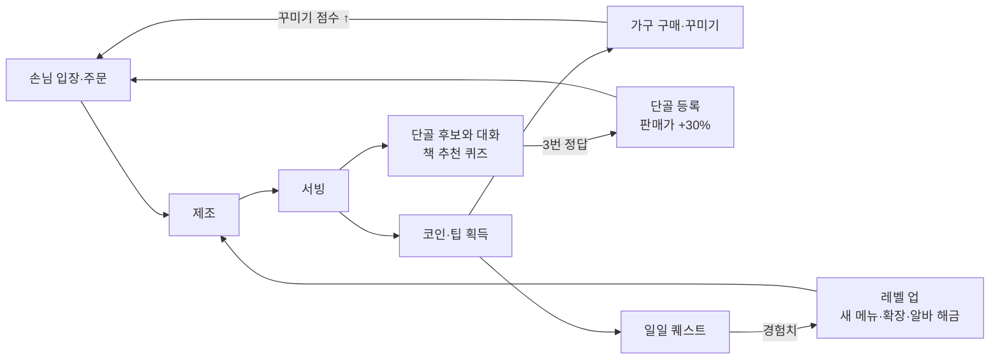

# 📚☕ 북카페 타이쿤 (BookStair)

> 커피를 만들어 팔고, 손님이 들려주는 이야기만 듣고 딱 맞는 책을 추천해 단골로 만드는
> **북카페 경영 시뮬레이션 웹 게임**

| 항목 | 내용 |
|---|---|
| 과제 | Project 1 (개인 프로젝트) |
| 제작 | 유채원 (디지털경영전공) |
| 장르 | 경영 시뮬레이션 · 타이쿤 · 캐주얼 |
| 플랫폼 | 웹 브라우저 (PC 권장, 작은 화면 대응) |
| 실행 | 설치 없이 [`index.html`](index.html) 한 파일을 브라우저로 열면 바로 실행 |
| 기술 | HTML · CSS · JavaScript (외부 라이브러리 없음), Canvas 2D, localStorage |
| 규모 | 약 8,000줄 · 메뉴 58종 · 책 49권 · 단골손님 50명 · 인테리어 테마 6종 · 뱃지 46개 |

---

## 목차

1. [기획 배경과 목표](#1-기획-배경과-목표)
2. [실행 방법](#2-실행-방법)
3. [게임 흐름](#3-게임-흐름)
4. [화면 구성과 조작법](#4-화면-구성과-조작법)
5. [게임 시스템 상세](#5-게임-시스템-상세)
6. [기술 구현](#6-기술-구현)
7. [UI/UX 설계](#7-uiux-설계)
8. [개발 과정](#8-개발-과정)
9. [한계와 앞으로 할 일](#9-한계와-앞으로-할-일)

---

## 1. 기획 배경과 목표

### 1-1. 문제의식

카페 타이쿤 장르는 "주문 받기 → 만들기 → 내기"가 재미의 전부인 경우가 많습니다.
처음에는 바쁘게 손을 움직이는 재미가 있지만, 같은 동작이 반복되면서 금방 지루해집니다.
손님은 주문 말풍선만 띄우고 사라지는 NPC라서 애착이 생기지 않고, 인테리어를 꾸며도 보기 좋은 것 말고는 달라지는 게 없습니다.

### 1-2. 해결 방향

카페에 **책**이라는 요소를 더해 세 가지를 바꾸는 것을 목표로 했습니다.

| 기존 타이쿤의 문제 | 북카페 타이쿤의 해결 방법 |
|---|---|
| 같은 작업만 반복해서 지루하다 | 손님이 말하는 줄거리나 감상만 듣고 책 제목을 맞히는 **책 추천 퀴즈**로 머리 쓰는 재미를 더함 |
| 손님이 그냥 지나가는 NPC다 | 이름·직업·취향이 정해진 **단골손님 50명**. 추천을 3번 맞혀야 단골이 되고, 단골은 30% 더 비싸게 사 감 |
| 꾸미기가 보기 좋은 것으로 끝난다 | **꾸미기 점수**가 오르면 손님 방문 빈도·인내심·단골 등장 확률이 실제로 올라감 |
| 오늘 다시 들어올 이유가 없다 | 일일 퀘스트, 주간 인기투표, 독서 클럽 주간 목표, 실제 날짜를 따르는 계절 한정 메뉴 |

### 1-3. 타깃 사용자

- 짧은 시간에 가볍게 즐기는 **캐주얼 게임 이용자**
- 카페·인테리어 꾸미기를 좋아하는 이용자
- 책을 좋아해서 아는 책이 나오면 반가운 이용자. 고전과 베스트셀러 49권을 골라, 처음 보는 책이라도 줄거리 힌트로 맞힐 수 있게 했습니다.

### 1-4. 핵심 재미 구조 (Core Loop)



- **짧은 루프 (몇 초):** 주문 → 제조 → 서빙 → 코인
- **중간 루프 (몇 분):** 가구 구매 → 꾸미기 점수 상승 → 손님 증가, 단골 후보에게 책 추천
- **긴 루프 (며칠):** 일일 퀘스트로 레벨 업 → 새 메뉴·카페 확장·알바 고용·2층 라운지 해금

---

## 2. 실행 방법

### 방법 1. 파일로 바로 열기 (권장)

1. 이 저장소에서 [`bookcafe-tycoon/index.html`](index.html)을 내려받습니다.
   (저장소 전체를 받으려면 GitHub 화면의 `Code → Download ZIP`)
2. `index.html`을 더블클릭해 크롬이나 엣지로 엽니다.

### 방법 2. 로컬 서버로 열기

```bash
cd bookcafe-tycoon
python -m http.server 8000
# 브라우저에서 http://localhost:8000 접속
```

### 참고

- **저장:** 진행 상황은 브라우저 `localStorage`에 자동 저장됩니다. 창을 닫았다 다시 열어도 이어서 할 수 있습니다.
- **초기화:** 오른쪽 위 **⚙️ 설정 → 처음부터 다시 → 초기화**를 누르면 모든 진행 상황이 지워집니다.
- **글꼴:** Google Fonts의 Jua 글꼴을 불러옵니다. 인터넷이 없으면 기본 글꼴로 보이지만 게임은 그대로 동작합니다.

---

## 3. 게임 흐름

### 3-1. 처음 시작할 때 (온보딩)

```
① 닉네임 입력 (최대 10자)
② 아바타 만들기 (성별·피부·눈·입·머리 모양·머리색·옷·모자)
③ 신규 점장 오픈 축하 선물
④ 숙련 튜토리얼: Lv.1 메뉴(아메리카노, 복숭아 아이스티) 레시피 배우기
⑤ 영업 시작
```

처음 하는 사람이 막히지 않도록 한 번에 하나씩만 보여 주고, 튜토리얼은 판정 구간을 평소보다 **1.6배 넓게** 잡아 쉽게 성공하도록 했습니다.

### 3-2. 기본 영업 흐름

```
손님 입장 → 빈 자리에 앉아 주문 말풍선
→ 제조 기구(커피머신 / 음료 바 / 케이크 진열대) 클릭해서 제조
→ 완성품 클릭해서 손에 들기 (최대 2개)
→ 주문한 손님 클릭해서 내기 → 코인 + 팁
→ 손님이 떠난 뒤 빈 접시 치우기
```

손님마다 **인내심 게이지**가 있어서 너무 오래 기다리게 하면 화를 내며 돌아갑니다.

---

## 4. 화면 구성과 조작법

### 4-1. 화면 구성

```
┌──────────────────────────────────────────────────────────────┐
│ [🔔 BOOK PARTY] [아바타 Lv.점장 ▬▬경험치]   🎨꾸미기 🎀우정 🪙코인 🥇금 ⚙️ │ ← 상단 HUD
│                                                       ┌──┐   │
│ ┌────┐                                                │🎁│ 일일 퀘스트
│ │주문│                                                │🗳️│ 인기투표
│ │알림│          카페 화면 (Canvas)                     │🏰│ 독서 클럽
│ └────┘                                                │📐│ 카페 확장
│ [👫친구들]                                            └──┘   │
│                                                              │
│ [손 ▢ ▢]                          [🔨꾸미기][🏰클럽][2F/1F][📖MENU] │ ← Dock
└──────────────────────────────────────────────────────────────┘
```

| 영역 | 들어 있는 것 | 배치 이유 |
|---|---|---|
| 상단 HUD | 이벤트 배지, 레벨·경험치, 재화 4종, 설정 | 계속 확인해야 하는 정보는 시선이 먼저 가는 위쪽에 |
| 오른쪽 이벤트 열 | 일일 퀘스트, 인기투표, 독서 클럽, 확장 | 남은 시간·진행도를 아이콘 아래 숫자로 바로 보여 줌 |
| 왼쪽 열 | 손님 주문 알림, 친구들 | 지금 처리해야 할 일을 한쪽에 모음 |
| 왼쪽 아래 | 손에 든 물건 2칸 | 무엇을 들고 있는지 헷갈리지 않게 |
| 오른쪽 아래 Dock | 꾸미기, 독서 클럽, 층 이동, 전체 메뉴 | 자주 누르는 버튼은 손이 가기 쉬운 오른쪽 아래에 |

### 4-2. 조작법

| 조작 | 동작 |
|---|---|
| 마우스 클릭 | 이동, 제조, 완성품 들기, 서빙, 접시 치우기, 단골 후보와 대화 |
| 🔨 꾸미기 → 드래그 | 가구 옮기기 |
| `R` | (꾸미기 중) 선택한 가구 회전 |
| `Delete` / `Backspace` | (꾸미기 중) 선택한 가구를 창고에 넣기 |
| `Esc` | 열린 창 닫기, 꾸미기 중이면 선택 해제 |
| `2F / 1F` 버튼 | 층 이동 (Lv.50부터) |
| `📖 MENU` | 상점, 아바타·알바, 도감·메뉴·뱃지, 인기투표, 친구/방명록 |

---

## 5. 게임 시스템 상세

### 5-1. 손님

| 항목 | 규칙 |
|---|---|
| 입장 간격 | `clamp(9 − 레벨 × 0.03, 3, 9)초 ÷ (1 + 꾸미기 방문 보너스)`에 ±30% 무작위. 레벨이 오르고 카페가 예쁠수록 손님이 자주 옴 |
| 인내심 | `(38 + 의자 편안함) × (1 + 꾸미기 인내심 보너스)`, 38~100 사이. 좋은 의자에 앉히면 더 오래 기다려 줌 |
| 책 구경 손님 | 책장·북스탠드가 있으면 책만 구경하러 오는 손님이 생기고, 책을 팔 수 있음 |
| 외모 | 피부 5종 × 머리색 8종 × 옷 색 8종을 시드값으로 조합해 손님마다 다르게 생성 |

### 5-2. 판매 가격과 팁

```
판매가 = 메뉴 기본가
       × 1.5  (계절 한정 메뉴일 때)
       × 1.1  (독서 클럽 대표가 방문 중일 때, 음료만)
       × 1.3  (단골손님일 때)
       × 1.2  (그 메뉴를 숙련도 PERFECT로 배웠을 때)

팁 = 판매가 × 0.3 × (남은 인내심 비율)  +  (PERFECT면 판매가 × 0.15)
```

빨리 내줄수록 팁이 커지므로, 손님이 몰릴 때 **무엇부터 처리할지** 판단하는 재미가 생깁니다.

### 5-3. 메뉴 58종

| 구분 | 수 | 제조 기구 | 해금 |
|---|---|---|---|
| 음료 | 30종 | 커피머신 / 음료 바 | Lv.1 아메리카노 ~ Lv.100 시공간 시그니처 블렌드 |
| 디저트 | 20종 | 케이크 진열대 (Lv.2부터 구매 가능) | Lv.2 플레인 스콘 ~ Lv.99 3단 애프터눈 티 세트 |
| 계절 한정 | 8종 (계절마다 2종) | 커피머신 / 음료 바 / 케이크 진열대 | Lv.3부터, 실제 날짜의 계절에만 주문이 들어옴 |

- **가격·경험치·제조 시간 공식:** 음료 가격 = `35 + 해금 레벨 × 2.4`, 제조 시간 = `2.6초 + 레시피 단계 수 × 0.4초`. 높은 레벨 메뉴일수록 비싸고 만드는 데 오래 걸립니다.
- **레시피 배우기:** 새 메뉴가 열려도 바로 팔 수 없습니다. 선배에게 레시피(머그잔 → 그라인더 → 탬핑 → 샷 → 스팀 …)를 순서대로 배워야 손님이 주문합니다.
- **미리 만들기:** 기구 하나에서 한 번에 5잔씩 만들어 둘 수 있습니다.

<details>
<summary><b>전체 메뉴 목록 펼치기</b></summary>

**음료 30종** (괄호 안은 해금 레벨)

복숭아 아이스티(1) · 아메리카노(1) · 아이스 아메리카노(2) · 카페라떼(3) · 바닐라라떼(4) · 녹차(5) · 카푸치노(7) · 헤이즐넛 아메리카노(9) · 카라멜 마키아토(12) · 녹차라떼(15) · 초코라떼(18) · 토피넛 라떼(22) · 연유 라떼(26) · 아인슈페너(30) · 자몽 에이드(34) · 청포도 에이드(38) · 얼그레이 밀크티(42) · 고구마 라떼(46) · 민트초코 라떼(50) · 콜드브루(55) · 콜드브루 라떼(60) · 말차 에스프레소(65) · 자몽 허니 블랙티(70) · 아포가토(75) · 핸드드립(80) · 플랫 화이트(85) · 체리 에이드(90) · 샤인머스캣 스무디(93) · 로얄 밀크티(97) · 시공간 시그니처 블렌드(100)

**디저트 20종**

플레인 스콘(2) · 초코칩 쿠키(4) · 슈크림빵(6) · 버터 크로와상(10) · 휘낭시에(14) · 치즈케이크(19) · 티라미수(24) · 가나슈 롤케이크(29) · 마카롱 3종(35) · 에그 타르트(40) · 베이글&크림치즈(48) · 아이스크림 브라우니(54) · 브라운 슈가 와플(60) · 딸기 생크림 케이크(68) · 생체리 타르트(74) · 당근 크림치즈 케이크(80) · 크로플(86) · 앙버터 다쿠아즈(90) · 파블로바(95) · 3단 애프터눈 티 세트(99)

**계절 한정 8종**

| 계절 | 음료 | 디저트 |
|---|---|---|
| 🌸 봄 (3~5월) | 벚꽃 딸기 라떼 | 쑥 인절미 찰떡 |
| 🌊 여름 (6~8월) | 청귤 스파클링 에이드 | 눈꽃 팥빙수 |
| 🍂 가을 (9~11월) | 밤 아인슈페너 | 단호박 타르트 |
| ❄️ 겨울 (12~2월) | 시나몬 뱅쇼 | 갓 구운 붕어빵 세트 |

</details>

### 5-4. 제조 미니게임 (숙련도)

음료 레시피를 배울 때 단계별 타이밍 미니게임을 합니다.

```
원두 갈기 → 탬핑 → 샷 추출 → 스팀 우유 또는 붓기
```

- 단계마다 **PERFECT / GREAT / GOOD / FAIL**로 판정합니다.
- 최종 등급은 단계 평균으로 정하고, FAIL이 2번 이상이면 전체 FAIL입니다.
- 가장 좋은 등급이 저장되고, **PERFECT를 받은 메뉴는 판매가 +20%에 팁 보너스**가 붙습니다. 그래서 이미 배운 메뉴도 다시 연습할 이유가 생깁니다.

### 5-5. 책 추천과 단골 시스템 (이 게임만의 핵심 기능)

**Lv.5**부터 단골 후보 손님이 찾아옵니다.

```
단골 후보 입장 → 클릭해서 대화
→ 손님이 책 제목 없이 "줄거리" 또는 "읽고 느낀 점"을 이야기함
→ 보기 4권 중에서 고르기 (정답 1 + 같은 장르 1 + 다른 장르 2)
→ 정답이면 하트 +1, 3개를 모으면 단골 등록
```

| 항목 | 내용 |
|---|---|
| 장르 6개 | 추리 · SF · 로맨스 · 인문학 · 자기계발 · 판타지 |
| 책 49권 | 『셜록 홈즈의 모험』, 『코스모스』, 『오만과 편견』, 『사피엔스』, 『미움받을 용기』, 『어린 왕자』 등 고전·스테디셀러 |
| 책마다 대사 2개 | 줄거리 1줄 + 읽고 느낀 점 1줄. 맞힌 횟수에 따라 번갈아 나오고, 대표 책을 맞히면 같은 장르의 다른 책을 찾아서 같은 손님이라도 문제가 달라짐 |
| 단골손님 50명 | 이름·직업·좋아하는 장르·대표 책이 정해져 있음. 예: 개발자 김민재(SF, 『코스모스』), 기관사 오건우(추리, 『오리엔트 특급 살인』) |
| 난이도 설계 | 같은 장르 오답을 1권 섞어서 장르만 보고 찍기 어렵게 함 |
| 보상 | 단골 등록 순간 코인(200 + 레벨×10)과 금 3개. 이후 단골이 사는 메뉴는 판매가 +30%. 꾸미기 점수가 높으면 단골 등장 확률이 최대 +15%p |

손님 직업과 좋아하는 책이 이어지도록 설정했습니다. 예를 들어 해양생물학자는 『해저 2만 리』, 수학 강사는 『용의자 X의 헌신』을 찾습니다.

### 5-6. 인테리어와 꾸미기 점수

**테마 6종** — 테마마다 카운터·테이블·의자·책장·조명·벽지·바닥 세트가 있습니다.

| 테마 | 콘셉트 | 가격 배율 | 제조 속도 | 의자 편안함 |
|---|---|---|---|---|
| 🪵 클래식 원목 | 포근한 전통 북카페 | ×1.0 | ×1.0 | 2 |
| 🌼 프로방스 내추럴 | 플라워 패턴·화이트 우드·식물 | ×1.4 | ×1.15 | 6 |
| 📻 레트로 빈티지 | 8090 다방 & LP판 | ×1.5 | ×1.2 | 5 |
| 🖤 모던 블랙&화이트 | 심플한 도시 감성 | ×1.6 | ×1.3 | 4 |
| 🏮 오리엔탈 한옥 | 전통 문살·좌식 평상·놋그릇 | ×1.8 | ×1.25 | 8 |
| 💎 럭셔리 골드/파스텔 | 마블 & 핑크 골드 (금으로만 구매) | 금 전용 | ×1.8 | 14 |

비싼 테마일수록 제조가 빠르고 손님이 오래 기다려 줍니다. 무엇을 먼저 살지 **투자 판단**을 하게 만들려는 설계입니다.

**꾸미기 점수**

```
꾸미기 점수 = 가구 점수 합 + 벽지·바닥 점수 + 테마 세트 보너스
테마 세트 보너스 = 같은 테마 5개 이상이면 +15, 10개 이상이면 +40 (테마별로 따로 계산)
```

점수가 600점에 가까워질수록 효과가 커지고, 600점에서 최대가 됩니다.

| 효과 | 최대치 |
|---|---|
| 손님 방문 빈도 | +50% |
| 손님 인내심 | +30% |
| 단골 후보 등장 확률 | +15%p |

벽과 바닥은 색을 직접 바꿀 수 있고, 카페 밖 풍경은 실제 계절(벚꽃·초록·단풍·눈)을 따라갑니다.

### 5-7. 카페 확장 · 알바 · 2층 라운지

**카페 확장 (8×8 → 13×13)**

| 단계 | 필요 레벨 | 크기 | 비용 |
|---|---|---|---|
| 1 | Lv.4 | 9×9 | 2,000 코인 |
| 2 | Lv.16 | 10×10 | 8,000 코인 + 금 10 |
| 3 | Lv.25 | 11×11 | 20,000 코인 + 금 30 |
| 4 | Lv.75 | 12×12 | 60,000 코인 + 금 100 |
| 5 | Lv.100 | 13×13 | 150,000 코인 + 금 250 |

**알바 고용 (최대 4명)** — 자리는 Lv.5 / 10 / 50 / 100에 하나씩 열립니다.

| 알바생 | 동물 | 이동 속도 | 한마디 |
|---|---|---|---|
| 민지 | 토끼 | ×1.0 | 책 정리는 맡겨 주세요! |
| 준호 | 강아지 | ×1.2 | 배달 알바 3년 차, 발이 빨라요. |
| 예린 | 고양이 | ×0.95 | 라떼아트 예선 통과했어요 ☕ |
| 태양 | 곰 | ×1.1 | 박자 맞춰 일하면 하나도 안 힘들어요! |
| 소라 | 양 | ×0.9 | 손님 얼굴은 한 번 보면 안 잊어요. |
| 하늘 | 여우 | ×1.3 | 카페 경력 5년! 뭐든 빨라요. |

**2층 독서 라운지 (Lv.50)** — 6×6으로 열리고 10레벨마다 한 칸씩 넓어집니다. 손님이 빈 의자에 앉아 책을 읽다가 일어날 때 이용료를 냅니다. 1층을 보고 있는 동안에도 2층 영업은 계속 돌아갑니다.

### 5-8. 성장: 레벨 · 퀘스트 · 뱃지 · 재화

**레벨 (1 → 100)**

- 다음 레벨까지 필요한 경험치 = `15 + 10 × 현재 레벨`
- 경험치는 **일일 퀘스트로만** 쌓입니다. 무작정 오래 플레이하기보다 매일 조금씩 들어오도록 유도하려는 설계입니다.
- 레벨 업마다 금 2개를 받고, 새로 열린 메뉴·확장·알바 자리를 팝업으로 알려 줍니다.

| 레벨 | 열리는 것 (주요 항목) |
|---|---|
| Lv.2 | 케이크 진열대·디저트 |
| Lv.3 | 계절 한정 메뉴 |
| Lv.4 | 첫 카페 확장 |
| Lv.5 | 단골손님 & 책 추천 대화, 알바 1번째 자리 |
| Lv.10 | 알바 2번째 자리 |
| Lv.50 | 2층 독서 라운지, 알바 3번째 자리 |
| Lv.100 | 마지막 확장(13×13), 알바 4번째 자리, 시그니처 블렌드 |

**일일 퀘스트** — 하루 6개가 3칸에 나눠 나오고, 레벨에 따라 목표치가 커집니다.

| 종류 | 예시 |
|---|---|
| ☕ 서빙 | 손님 N명에게 내기 |
| 🪙 매출 | 코인 N 벌기 |
| 🍰 특정 메뉴 | ○○ 2번 팔기 |
| 🧽 청소 | 빈 테이블 N번 치우기 |
| ⚡ 빠른 서빙 | 인내심이 절반 남았을 때 내기 N번 |
| 🫘 로스팅 | 원두 로스팅 2번 거두기 |
| 📚 책 판매 | 책 구경 손님에게 책 2권 팔기 |
| 💬 책 추천 | 단골 후보에게 책 추천 맞히기 |
| 📝 방명록 · 🧹 일손 돕기 | 친구 카페 방문 |
| 🗳️ 투표 | 주간 인기투표 참여 |
| 🛍️ 구매 | 상점에서 가구·벽지 1개 사기 |

할 수 없는 퀘스트는 나오지 않습니다. 예를 들어 로스터가 없으면 로스팅 퀘스트가 나오지 않습니다.

**뱃지 46개** — 영업 / 레시피 / 단골 / 카페 / 소셜·클럽 5분류, 동·은·금 등급. 예: 「첫 잔」(처음 메뉴 내기), 「퍼펙트 바리스타」(음료 30종 모두 PERFECT), 「꿈의 카페」(13×13 확장). 장르마다 「명탐정의 친구」, 「우주 여행자」 같은 장르 뱃지도 있습니다.

**재화 4종**

| 재화 | 얻는 방법 | 쓰는 곳 |
|---|---|---|
| 🪙 코인 | 판매·팁, 책 판매, 단골 등록, 인기투표 참여·순위 보상 | 기본 가구, 알바 고용, 확장 |
| 🥇 금 | 오픈 선물(50), 레벨 업(+2), 퀘스트 모두 완료(+2), 단골 등록(+3), 독서 클럽 주간 목표(+10), 뱃지 | 고급·럭셔리 가구, 상위 확장, 알바 고용 |
| 🎀 우정 포인트 | 친구 카페 일손 돕기(+5), 방명록(+10) | 친구 관계 기록 (소셜 지표) |
| 🎨 꾸미기 점수 | 가구·벽지·바닥 배치 | (재화가 아니라 카페 능력치) |

### 5-9. 소셜 기능 (목업)

| 기능 | 내용 |
|---|---|
| 친구 · 방명록 | 이웃 카페에 친구 신청, 방명록 남기기, 일손 돕기(하루 3번) |
| 주간 인기투표 | 일주일에 5표. 5표를 다 쓰면 800 코인, 주간 순위에 따라 1위 10,000 / 2위 5,000 / 3위 1,000 코인 |
| 독서 클럽 | 4개 클럽 중 가입하거나 직접 만들기. 클럽원 합계 주간 판매 400잔 목표(달성 시 금 10), 아지트 5단계 꾸미기, 클럽 대표가 카페에 오면 음료 판매가 +10% |

서버가 없기 때문에 친구, 다른 카페, 클럽원은 미리 만들어 둔 가상 데이터입니다.
실제 서비스라면 어떤 소셜 기능이 필요할지 **화면과 흐름을 먼저 설계해 본 것**입니다.

---

## 6. 기술 구현

### 6-1. 기술 선택 이유

| 선택 | 이유 |
|---|---|
| **파일 1개 (HTML)** | 채점·공유할 때 설치나 빌드 없이 더블클릭만으로 실행되게 하려고 |
| **외부 라이브러리 없음** | 게임 엔진 없이 게임 루프, 길찾기, 렌더링이 어떻게 돌아가는지 직접 구현해 보려고 |
| **Canvas 2D 도형만 사용** | 이미지 파일 없이 캐릭터·가구·음료를 코드로 그려서 테마 색만 바꿔도 가구 6세트가 나오게 하려고 |
| **localStorage** | 서버 없이도 진행 상황을 이어서 할 수 있게 하려고 |

### 6-2. 코드 구성

[index.html](index.html) 안의 `<script>`는 7개 구역으로 나뉩니다.

| 구역 | 줄 수(약) | 내용 |
|---|---|---|
| 1. 데이터 | 620 | 장르, 책과 대사, 단골 50명, 메뉴, 레시피 도구, 가구·테마, 알바, 뱃지, 소셜 목업 |
| 2. 유틸·저장·재화/레벨 | 460 | DOM 생성 도우미, 저장/불러오기, 날짜별 초기화, 일일 퀘스트, 경험치·레벨 업 |
| 3. 카페 시뮬레이션 | 780 | 격자, 길찾기, 손님 행동, 제조, 알바 판단, 1·2층 동시 운영 |
| 4. 그리기 | 3,500 | 캐릭터(동물 10종 포함), 가구, 음료, 벽·바닥 무늬, 계절 풍경 |
| 5. 메인 화면 | 670 | 렌더링 루프, 클릭/드래그, 인테리어 편집, HUD 갱신 |
| 6. 모달 UI | 1,490 | 온보딩, 상점, 확장, 아바타, 알바, 도감, 대화, 친구, 클럽, 투표, 미니게임, 설정 |
| 7. 시작 | 70 | 저장 불러오기, 이벤트 연결, 게임 루프 시작 |

### 6-3. 상태 관리: 저장하는 상태와 실행 중 상태 분리

```
S (저장 상태)  ── localStorage에 JSON으로 저장
  레벨·경험치·재화, 가구 배치, 카페 크기, 알바, 단골 기록, 레시피·숙련도,
  뱃지, 퀘스트, 친구·방명록, 투표, 독서 클럽, 층별 배치 ...

W (실행 중 상태)  ── 저장하지 않음, 새로고침하면 다시 만들어짐
  지금 있는 손님·알바의 위치와 경로, 기구 제조 진행도,
  더러운 테이블, 말풍선, 파티클 ...
```

- 저장 키는 `bookcafe-tycoon-save-v1`이고, 데이터에 버전(`v: 1`)을 넣어 두었습니다. 예전 형식의 아바타 데이터는 불러올 때 새 형식으로 바꿉니다(`migrateAvatar`).
- 날짜가 바뀌었는지 확인해서 일일 퀘스트, 일손 돕기 횟수 같은 하루 단위 데이터를 초기화합니다(`ensureDaily`).

### 6-4. 길찾기 (BFS)

손님, 알바, 플레이어는 가구를 피해서 움직여야 합니다. 카페를 격자로 보고 **너비 우선 탐색(BFS)**으로 최단 경로를 찾습니다(`findPath`).

```
시작 칸에서 상하좌우로 한 칸씩 넓혀 가며 탐색
→ 가구가 있는 칸은 지나갈 수 없음 (단, 목적지인 의자·기구는 들어갈 수 있음)
→ 목적지에 닿으면 지나온 칸을 거꾸로 따라가 경로 생성
```

최대 13×13(169칸)이라 매번 새로 계산해도 충분히 빠르고, 가구를 옮기면 격자를 다시 만들기만 하면 됩니다.

### 6-5. 알바 AI (우선순위 판단)

알바생은 매번 아래 순서대로 할 일을 찾고, **다른 직원이 이미 맡은 일은 건너뜁니다**. 그래서 여러 명이 같은 손님에게 몰려가지 않습니다.

```
1. 손에 든 완성품이 있으면 → 그걸 주문한 손님에게 가져다주기
2. 다 만들어진 음료가 있고 기다리는 손님이 있으면 → 가지러 가기
3. 아직 아무도 안 만드는 주문이 있으면 → 비어 있는 기구에서 만들기
4. 할 일이 없으면 → 빈 접시 치우기
```

### 6-6. 1층 · 2층 동시 운영

화면에는 한 층만 보이지만 두 층의 영업이 모두 돌아가야 합니다.
층마다 배치(`S`)와 실행 상태(`W`)를 따로 보관하고, 매 프레임 두 층을 번갈아 꺼내 시뮬레이션합니다(`withFloor`, `swapTo`).
덕분에 기존 1층 코드를 고치지 않고 2층을 추가할 수 있었습니다.

### 6-7. 게임 루프

`requestAnimationFrame`으로 매 프레임 `경과 시간(dt)`만큼 시뮬레이션을 진행합니다. 탭을 잠깐 내렸다 돌아와도 한꺼번에 튀지 않도록 dt는 최대 0.1초로 제한합니다. 창(모달)이 열려 있거나 꾸미기 중일 때는 영업이 멈춥니다.
손님 입장 타이머, 인내심 감소, 이동, 제조 진행이 모두 `dt` 기준이라 컴퓨터 성능이 달라도 게임 속도가 같습니다.

---

## 7. UI/UX 설계

| 원칙 | 적용한 방법 |
|---|---|
| **처음 하는 사람이 막히지 않게** | 온보딩을 2단계로 나누고, 튜토리얼 판정을 1.6배 넓게, 레벨 업할 때마다 "새로 열린 것"을 목록으로 보여 줌 |
| **기능이 많아도 복잡해 보이지 않게** | 자주 쓰는 것(꾸미기·클럽·층 이동)만 Dock에 두고, 나머지는 `MENU` 안에 묶음 |
| **눌러 보면 알 수 있게** | 재화 아이콘에 마우스를 올리면 어디에 쓰는지 알려 주고, `+` 버튼은 그 재화를 모으는 곳으로 바로 연결 |
| **결과가 바로 보이게** | 서빙하면 `+코인 (팁 N)` 숫자와 하트·별 파티클, PERFECT면 별도 표시 |
| **할 수 없는 건 보여 주지 않기** | 조건이 안 되는 퀘스트는 나오지 않고, 온보딩 전에는 메뉴 버튼이 동작하지 않음 |
| **분위기 통일** | 파스텔 레트로 색감, 둥근 Jua 글꼴, 진한 갈색 외곽선으로 모든 그림과 버튼의 톤을 맞춤 |
| **작은 화면 대응** | 화면 폭 1000px·720px·640px 기준으로 버튼 크기, 아이콘, 배치를 다시 잡음 |

---

## 8. 개발 과정

1. **기획:** 카페 타이쿤에 책 추천을 더한다는 콘셉트를 정하고, 핵심 루프와 필요한 기능을 정리했습니다.
2. **프롬프트 설계:** Gemini에게 만들고 싶은 게임의 방향을 설명하고, 기능별로 나눈 구현 프롬프트를 받았습니다.
3. **구현:** 받은 프롬프트를 Claude Code에 옮겨 기능을 하나씩 구현하고, 직접 플레이해 보며 고칠 점을 다시 요청했습니다.
4. **캐릭터 디자인 개선:** 캐릭터가 어색하다는 문제를 풀기 위해 머리·눈·옷을 부위별로 나눈 **파츠 시트**를 만들고, 부위마다 따로 다듬었습니다. 같은 파츠를 아바타 꾸미기에도 그대로 써서 플레이어가 조합할 수 있게 했습니다.
5. **밸런스 조정:** 가격·제조 시간·경험치를 메뉴마다 따로 정하지 않고 해금 레벨과 레시피 길이로 계산하는 공식으로 바꿔서, 메뉴 58종의 밸런스를 한 번에 맞췄습니다.

---

## 9. 한계와 앞으로 할 일

### 한계

- **서버가 없음:** 친구, 인기투표, 독서 클럽은 실제 다른 사람과 연결되지 않는 목업입니다.
- **저장이 브라우저에만 남음:** 다른 기기나 브라우저에서는 이어서 할 수 없고, 브라우저 데이터를 지우면 진행 상황도 사라집니다.
- **파일 1개 구조:** 실행은 쉽지만 8,000줄이 한 파일에 있어 기능을 더할수록 고치기 어려워집니다.
- **사용자 테스트 부족:** 밸런스와 난이도를 실제 이용자 여러 명에게 검증하지 못했습니다.

### 앞으로 할 일 (캡스톤으로 이어서 개발)

- 캐릭터와 화면 디자인을 더 다듬기 (UI/UX 중심)
- 실제 이용자 플레이 테스트로 온보딩과 난이도 개선
- 코드를 기능별 파일로 나누고 테스트 추가
- 서버를 붙여 친구·투표·클럽을 실제 기능으로 만들기

---

## 파일 구조

```
bookcafe-tycoon/
├── index.html   # 게임 전체 (HTML + CSS + JavaScript)
└── README.md    # 이 문서
```
